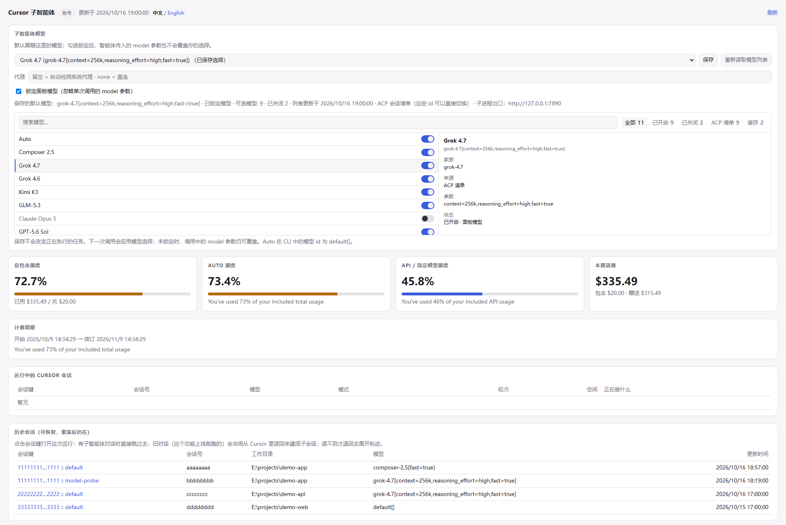
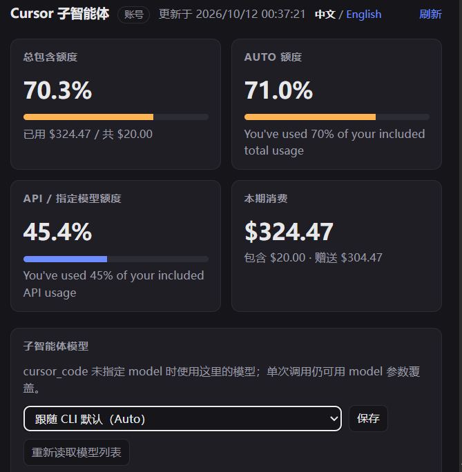

# dsh-cursor-dev

**一句话：你聊天的那个模型负责想，本机的 Cursor CLI 负责写代码。**



[中文](#中文) · [English](#english)

---

## 中文

### 这个插件是干嘛的

装好之后，你在 DSH 里聊天的那个模型（父模型）手上会多一把工具：**`cursor_code`**。

它的分工是这样的：

- **父模型**：听懂你要什么、决定怎么改、拆任务、验收。
- **Cursor CLI**：在你自己的工作区里真的动手——建文件、改代码、跑命令。

你不用记任何参数。直接在对话里用人话说就行：

> 帮我把登录页加上验证码，样式跟注册页保持一致，改完把测试跑一遍。

父模型自己会判断要不要派给 Cursor，并把任务写全（要改哪些文件、验收标准是什么）再递过去。派活的活它干，你只看结果。

### 三步用起来

**第一步：装好并登录 Cursor CLI**（插件不替你做这一步，只负责告诉你缺哪一步）

```sh
# Windows PowerShell
irm 'https://cursor.com/install?win32=true' | iex

# macOS / Linux
curl https://cursor.com/install -fsS | bash

agent login                  # 会打开浏览器授权
agent status --format json   # 看到 "isAuthenticated": true 就成了
```

没装或没登录也不用慌：插件照常挂载，面板会直接告诉你缺的是哪一步、要跑哪条命令。

**第二步：装插件**

```sh
dsh plugin add dsh-cursor-dev
```

桌面版没有 `dsh` 命令，就在 profile 里登记：

```jsonc
// <profile>/package.json
{
  "dsh": { "profile": { "bundles": [/* …, */ "dsh-cursor-dev"] } },
  "dependencies": { "dsh-cursor-dev": "file:E:/github project/dsh-cursor-dev" }
}
```

装完**重启 DSH**，`cursor_code` 就出现在工具列表里了。

**第三步：开始派活**

就这么说：

| 你想干什么 | 直接这么说 |
| --- | --- |
| 让它写功能 | 「让 Cursor 把 XX 实现了，验收标准是 YY」 |
| 接着上一轮改 | 「让它继续，把测试也补上」（同一个 Cursor 会话，它记得自己改过什么） |
| 换个更强的模型 | 「这次用 grok-4.7 来做架构设计」 |
| 只要方案，别动代码 | 「让它先出个方案，别改文件」 |
| 指定它先看哪些文件 | 「让它看 `lib/index.js` 和 `lib/tool.js` 再动手」 |
| 看它在干什么 | 打开 **设置 → Cursor 子智能体** |

一个完整的例子（可以直接复制改改）：

```text
用 cursor_code 给这个工作区加一个「导出 CSV」的功能：
- 入口放在 src/export/csv.ts，导出函数签名保持和 json 导出一致
- 相关文件：src/export/json.ts、src/types.ts
- 验收标准：npm test 全绿，并且新增一个 csv 导出的单测
- 跑完告诉我改了哪些文件
```

懒得写整句，就用命令（可选）：

```text
/cursor-subagent 给这个工作区加一个「导出 CSV」的功能，入口 src/export/csv.ts
/cursor-subagent -m grok-4.7-xhigh 先出一份重构方案，别改文件
```

在输入框打 `/` 就能看到它。**分工是固定的：命令直接把活儿派给 Cursor 子智能体去写**——不进模型历史，也不先问父模型要不要做这件事，所以不会出现「父模型自己把代码写了」；Cursor 写完后，插件把结果（改了哪些文件、+/- 多少行、用的哪个模型、它自己的说明）作为一条普通消息发给父模型，由**父模型审查**这些代码：核对 diff、跑测试、按验收标准验证。发现问题再用 `cursor_code` 带 `continueSession: true` 让它接着改（还是同一个 Cursor 会话，它记得自己写过什么）。`-m` 只覆盖这一次调用的模型，不写就用面板里设的默认。

### 它凭什么比「让模型自己写」靠谱

- **看得见它干了什么** —— 每次调用都返回逐步的工具时间线和**真实文件 diff**（改前/改后原文），UI 里直接渲染成 diff 卡片。不是让你相信一段总结。
- **点开就是完整对话** —— 每次调用都会在**当前会话的页头**留一条子智能体记录（那个「N 个子智能体」的小按钮）。点开就是这次运行的完整记录：你交给它的任务、它每一步调了什么工具、每个文件改了什么、它最后说了什么。这就是 Cursor 的对话被映射进 DSH 的样子，不是另开一个页面。
- **改了文件它赖不掉** —— 回合前后各扫一遍文件指纹，**用 shell 命令写出来的文件也算**（这种改动压根不会出现在 ACP 流里）。
- **会话能续，DSH 重启也能续** —— `continueSession: true` 复用同一个 Cursor 会话；进程被回收、甚至 DSH 重启之后，会话还能从 Cursor 自己的会话库里 `session/load` 回来，它记得自己上一轮改了什么。**子智能体对话也跟着续**：接着改就是同一个对话记录里多一个回合，不会变成两条记录。**老会话还能补录**：装这个插件之前跑的会话，在面板里点一下就能把完整对话读回来建成子智能体对话——纯本地读取，不花额度。
- **按活挑模型** —— 杂活用便宜的（composer-2.5），架构用贵的（grok-4.7），档位后缀 `[reasoning_effort=high,fast=true]` 原样透传。嫌每次写麻烦？面板里选一次，以后默认就用它。

### 面板：设置 → Cursor 子智能体

不用问模型、不用翻日志，这些都在面板里（默认中文，右上角一键切 English）：



- **额度** —— 包含额度、Auto 桶、API 桶、本期花费、计费周期，30 秒自动刷新。
- **子智能体模型** —— 下拉列的是**会话真实接受的 id**（ACP 会话目录优先，拿不到才退到 CLI 的 `--list-models` 别名列表），点保存就生效，**下一次调用就用它**，不用重启。留空 = 跟随 CLI 默认（Auto → `default[]`）。账户不提供的模型会被标成不可用，而不是让整轮调用失败。
- **会话** —— 上半张表是当前活着的进程（会话 id、模型、模式、回合数、**正在干什么**）；下半张表是历史会话。**点会话键直接跳到那次运行的子智能体对话**（页面会顺手收起，不然它挡着刚打开的那条）；**旧对话也能点**：这个功能上线前跑的会话本来没有对话记录，点它会当场从 Cursor 自己的会话库里读回来、建成一条能点开的子智能体对话（纯本地读取，不花额度，最多一分钟），读完直接跳过去。真读不到（这台机器没有 agent loop、或 Cursor 那边已经删了）才退回去展开那一轮的执行日志：任务、模型、逐步时间线。

额度数据是从本机 Cursor 自己的凭据（`%APPDATA%\Cursor\auth.json`）只读调它的 dashboard RPC 拿的，**token 不会被记录、不会出现在任何响应里**。你也可以直接开 <http://127.0.0.1:19387/plugins/dsh-cursor-dev/> 看同一个页面（DSH 桌面版运行时）。

### 想知道细节？`cursor_code` 的参数

| 参数 | 类型 | 说明 |
| --- | --- | --- |
| `task` | string，**必填** | 完整任务：目标、要改什么、验收标准。**子智能体看不到你的对话**，这是它唯一的输入。 |
| `contextFiles` | string[] | 让它先读的文件，比手写一大段上下文便宜得多。 |
| `acceptance` | string | 验收条件／约束，例如「保持公开 API 不变」「收工前跑 pytest」。 |
| `model` | string | 本次任务用的模型，如 `composer-2.5`、`grok-4.7`、`kimi-k3`、`glm-5.2`。省略则用面板里选的（再退回到 CLI 默认）。 |
| `mode` | `agent` \| `plan` \| `ask` | 默认 `agent`（会改文件）；`plan` / `ask` 只读。 |
| `continueSession` | boolean | 默认 `false`；`true` = 接着同一个 Cursor 会话继续。 |
| `sessionLabel` | string | 给这条对话起个名字，方便并行维护多条工作线。默认 `default`。 |
| `resetSession` | boolean | 清掉本插件记的会话 id，让它没法再 load（不会删 Cursor 自己的数据）。 |
| `workspaceRoot` | string | 子智能体的工作目录，省略则用当前会话的工作目录。 |
| `report` | `summary` \| `detailed` | 默认 `summary`；`detailed` 额外给思考摘要和更细的步骤。 |
| `timeoutSeconds` | number | 单回合墙钟预算，默认 `1800`，上限 `7200`。 |

返回：`ok`、`cursorSessionId`、`childSessionId`（这次运行的子智能体对话 id，可在页头点开）、`reused` / `reloaded`、`model`、`mode`、`stopReason`、`durationMs`、`text`（子智能体的最终消息）、`steps`（工具时间线）、`changes`（变更清单，标注 `source: "acp" | "fs"` 和 `operation`）、`preview`（真实 `{path, oldText, newText}`）、`reasoning`、`error`。

**该用它就别客气**（真正落地的实现工作：写/重构代码、修 bug、加测试、跨文件机械改动）；**不该用它就别浪费**（能自己回答的问题、读文件——用你自己的工具）。

### 让它进 Agent Teams 干活

`cursor_code` 是普通工具，所以 Agent Teams 里的任何成员都能叫它——把 Cursor 当**团队里那只便宜的代码手**用：

- **同一条工作线用同一个 `sessionLabel`** —— 队友甲用 `"auth"`，队友乙用 `"ui"`，两个人的上下文就不会互相污染（会话键是 `标签 + 工作目录`）。
- **要接着上一轮改，就 `continueSession: true`** —— Cursor 自己记住它已经改了哪几个文件；换了个模型再续（比如从 `composer-2.5` 换到 `kimi-k3`）会被识别成「换模型」，自动开新会话，不会把上一代的上下文带过去。
- **一个成员一个工作目录/一棵文件树** —— 池里的回合是串行跑的，同一棵树里两个人同时改还是会让 diff 互相交叠；用 `workspaceRoot` 或各自的分支把写范围分开。
- **派活的活交给父模型** —— 验收标准（哪些文件、什么算「做完」）写进 `acceptance`，子智能体看不到你的对话，`task` 是它唯一的输入。

### 配置

```jsonc
{
  "model": "",                       // 传给子进程的默认模型；留空用 CLI 默认。面板里选的优先于这项
  "command": "",                     // 手动指定 Cursor CLI 路径（留空自动探测）
  "maxLiveSessions": 3,              // 池里保持存活的 Cursor 进程数
  "sessionIdleMinutes": 15,          // 空闲多久回收
  "maxScanFiles": 20000,             // 单次文件指纹扫描上限
  "toolName": "cursor_code",         // 注册的工具名
  "usageBaseUrl": "https://api2.cursor.sh",
  "usageUi": true                    // 关掉只影响面板，不影响编码工具
}
```

面板里改的东西存在插件数据目录的 `settings.json`，**不写你的 profile 配置**：改模型、改语言都立刻生效，不用重启。

### 数据落在哪

`%LOCALAPPDATA%\dsh-cursor-dev`（可用环境变量 `DSH_CURSOR_DEV_DATA` 覆盖），只有两个文件：对话索引 `conversations.json`、面板设置 `settings.json`。执行日志在内存里，带 TTL。

### 几个坑（提前说清楚）

- **Cursor CLI 的模型是全局的，不是按会话的**（实测：在 A 会话切模型，没碰过的 B 会话也会变，而且跨进程、跨重启留着）。所以本插件的调用是**串行**的，免得切模型污染另一条工作线。
- **两个模型 id 命名空间，别混着用**（这就是「面板选了模型结果整轮调用失败」的老 bug）：`cursor-agent --list-models` 印的是**别名**（`auto`、`composer-2.5`、`kimi-k3-max`、`glm-5.2-high`、`cursor-grok-4.6-high`…），而 `session/set_config_option` 只认**带参数的 id**（`default[]`、`composer-2.5[fast=true]`、`kimi-k3[reasoning=max]`、`glm-5.2[reasoning=high]`、`grok-4.6[effort=high,fast=true]`…）。插件现在一律拿面板/参数里的选择去会话自己的目录里解析，把别名映射成会话接受的 id，参数缺失时按基名重试一次，解析不出来就在**调用前**报 `cursor/model-unknown` 并列出可用的 id。
- **档位是 id 的一部分，不是每个模型都真有那么多档** —— CLI 列的 `grok-4.7-low/-medium/-high/-xhigh` 在当前账户里都指向同一个 `grok-4.7[context=256k,reasoning_effort=high,fast=true]`；面板显示的是**会话目录**里的那 10 个 id，别指望别名能变出账号没有的档位。
- Windows 上被回收的 Cursor 子进程可能短暂占着工作目录（`EBUSY`），测试里已做重试。
- 会话至少跑完一个回合才会被 Cursor 落盘，在那之前 `session/load` 会报 `Session not found`；本插件只在确实存在过会话时才去 load。

### 开发与测试

```bash
npm test        # node --test --test-force-exit "test/**/*.test.mjs"
```

146 个测试、10 个文件，**不需要 DSH**：真实的 Cursor CLI + 真实插件模块，覆盖模型切换、两个模型 id 命名空间（`auto` ⇄ `default[]`、别名 ⇄ 带参数的 id）之间的解析与比较、CLI 列表里带 `cursor-` 工作区前缀的别名到会话清单 id 的映射、`probeModelRoster` 会话清单与 `--list-models` 别名列表的来源优先级、**续聊判定说同一种模型（别名与它的带参数 id 算同一个，真换模型才开新会话）**、`continueSession` 复用、**新进程 `session/load` 后仍记得自己写过什么**、真实 diff、坏模型报错、额度 RPC 及其降级、把路由挂到真实 HTTP 服务上跑一遍、「**webServer 还没就绪时一条路由都不许挂、就绪后六条全挂上**」、「找不到 CLI 时插件照样挂载、只有工具报错」、返回值必须能无损序列化（否则一次成功的运行会被宿主当成失败丢掉）、`/cursor-subagent` 命令（注册形状、任务与 `-m` 的拆分、空任务只报用法、**命令自己把活派给子智能体而不是先问父模型**、跑完把「改了哪些文件/用的哪个模型/它自己的说明」交给父模型审查、运行失败也变成一条消息而不是消失）、**子智能体对话镜像**（一个回合写成的完整 DSH 事件序列、surface 规则——`user/message`/`assistant/message`/`tool/result` 必须带 `surfaceOp` 而 `tool/call` 绝不能带、工具卡片用 `sourceEventSeqs` 配对自己的调用、没报结果的调用在收尾时补一条、重复的工具更新只开一张卡、第二个回合接在同一个对话里、被中断的回合不会被丢掉、失败/取消/超限三种收尾、描述符与目录条目跟运行时写的一模一样、子对话继承父路由并带上层级、**记着的子对话要重新打开而不是再开一个**、宿主没有 agent loop 时静默降级、活着的子对话数量有上限）、**把旧对话读回来**（replay 按每次提问切成回合、一个提问被拆成多段也算同一回合、重放开头就有的内容不许丢、补录出来的回合和实跑的回合长得一模一样、**父会话早就不在了也能建**、点第二次还是同一个对话、读不回来时如实报错而不是假装成功、**replay 会拿住那把全局回合锁**、**重放一个活着的会话会先把它关掉**——CLI 的会话库是单写者），以及面板这一侧：模型列表解析与缓存、设置的读/合并/原子写、面板选择与 profile 配置的优先级、`settings` 路由、**点会话键跳进子智能体对话的那条跨窗口消息**（地址原样透传、**不同来源或格式不对的消息一律丢掉**、宿主没有工作区服务时不装监听也不吵）、`agent status --format json` 的登录状态解析与 60 秒缓存（含超时与未登录两种降级），还有浏览器半边的设置页与新装引导卡片（含**开机竞态**的回归测试）。

---

## English

**Run the Cursor CLI as a child coding agent under your DSH parent model: the model you chat with decides, Cursor does the work.**

### What it is

After installing, the model you chat with gets one more tool: **`cursor_code`**. That model plans, decides and reviews; the Cursor CLI already installed on your machine does the actual editing inside your workspace.

You do not have to remember any parameter — just say what you want in plain language:

> Add a CAPTCHA to the login page, keep the styling consistent with the signup page, and run the tests when you're done.

The parent model decides whether to delegate, writes the task out in full (which files, what "done" means) and hands it over.

### Three steps

**1. Install and sign in to the Cursor CLI**

```sh
# Windows PowerShell
irm 'https://cursor.com/install?win32=true' | iex
# macOS / Linux
curl https://cursor.com/install -fsS | bash

agent login                  # opens the browser
agent status --format json   # expect "isAuthenticated": true
```

A missing or signed-out CLI never takes the plugin down: the panel tells you which step is missing and prints the command that fixes it.

**2. Install the plugin**

```sh
dsh plugin add dsh-cursor-dev
```

On the desktop app (no `dsh` CLI), register it in your profile: add `"dsh-cursor-dev"` to `dsh.profile.bundles` and point `dependencies` at this package, then install and **restart DSH**.

**3. Delegate**

| What you want | Just say |
| --- | --- |
| Write a feature | "Have Cursor implement XX, done means YY" |
| Keep going on the same work | "Let it continue and add the tests too" (`continueSession`) |
| A stronger model this time | "Use grok-4.7 for the architecture" |
| A plan, no edits | "Have it propose a plan without touching files" (`mode: plan`) |
| Point it at files | "Have it read `src/a.ts` first" (`contextFiles`) |
| Watch it work | Open **Settings → Cursor child agent** |

Or use the command, if you would rather not write the sentence:

```text
/cursor-subagent add a CSV export to this workspace, entry point src/export/csv.ts
/cursor-subagent -m grok-4.7-xhigh propose a refactor plan, do not edit files
```

Type `/` to find it. The division of labour is fixed: **the command dispatches straight to the Cursor child** — nothing enters model history and the parent model is never asked whether to delegate, so it cannot end up writing the code itself. When Cursor is done, the plugin sends the outcome (files changed, +/- counts, the model that ran, the child's own summary) to the parent as one ordinary message so the **parent reviews** the work: check the diff, run the tests, then ask for another pass with `cursor_code` + `continueSession: true` (same Cursor conversation). `-m` overrides the model for that run; without it the panel's default applies.

### Why it beats "just let the model write it"

Every call returns a step-by-step tool timeline and the **real `{oldText, newText}` diffs**, rendered as a diff card — you verify, you don't trust a summary. A filesystem fingerprint before and after the turn catches changes the ACP stream never mentions (shell writes, moves, deletes). `continueSession: true` keeps the same Cursor conversation, and it survives a process reap **and a DSH restart** (`session/load`). Conversations that predate this plugin can be read back from Cursor's own store and turned into a child conversation with one click in the panel — again a purely local read. Models are picked per job, or once in the panel.

Every call also leaves a **child conversation in the current session header** (the "N subagents" button): open it and you get the run as it happened — the task you handed over, each tool Cursor called, what each file edit changed, and the child's closing message. That is Cursor's conversation mapped into DSH rather than a separate viewer, and continuing the work appends a turn to the same record instead of creating a second one.

The panel (**Settings → Cursor child agent**, Chinese by default with a one-click English switch) shows quota, live sessions with what each is doing, durable conversations and the model picker. **Click a session key to jump straight to that run's child conversation** (the panel closes itself on the way — otherwise it would cover the session it just opened). **Old conversations work too**: runs from before this feature have no child record, so the click reads that conversation back out of Cursor's own session store and builds one, then jumps to it — a purely local read, it spends no quota and takes at most a minute. Only when that is genuinely impossible (a host without an agent loop, or a conversation Cursor has since dropped) does the click fall back to unfolding that run's step timeline. Usage comes read-only from Cursor's own local credentials; the token is never logged or returned. The same page is served at `http://127.0.0.1:19387/plugins/dsh-cursor-dev/`.

### Parameters, if you want them

`task` (required, the child sees only this), `contextFiles`, `acceptance`, `model`, `mode` (`agent` / `plan` / `ask`), `continueSession`, `sessionLabel`, `resetSession`, `workspaceRoot`, `report` (`summary` / `detailed`), `timeoutSeconds` (default 1800, max 7200). Use it for real implementation work; use your own tools for reading files and answering questions.

### Using it inside Agent Teams

`cursor_code` is an ordinary tool, so any team member can call it — the cheap pair of hands that writes while the parent model and its teammates plan and review. Give each work line its own `sessionLabel` (the key is `label + working directory`) so two teammates never share one Cursor context; pass `continueSession: true` to keep editing the same conversation, and know that switching to a genuinely different model opens a fresh generation on purpose instead of inheriting the old one. Turns are serialized across the pool (the CLI's model is global — see Notes), so keep teammates in separate working directories or write scopes; serialization removes the model race, not the file-level overlap.

### Notes

The Cursor CLI applies the model **globally**, not per session, so this plugin serializes turns to keep a model switch from affecting another work line. Panel choices are stored in the plugin's own data directory (`%LOCALAPPDATA%\dsh-cursor-dev`), never in your profile config, and take effect on the next call. Routes: `/plugins/dsh-cursor-dev/` (dashboard), `/api/usage`, `/api/journal`, `/api/restore` (builds a child conversation from an old run), `/api/settings` (writes plugin settings) and `/status`.

Two model-id name spaces exist and must not be confused (this is the old "the panel had a model selected and the whole call failed" bug): `cursor-agent --list-models` prints **aliases** (`auto`, `composer-2.5`, `kimi-k3-max`, `glm-5.2-high`, `cursor-grok-4.6-high`, …), while `session/set_config_option` accepts only **parameterised ids** (`default[]`, `composer-2.5[fast=true]`, `kimi-k3[reasoning=max]`, `glm-5.2[reasoning=high]`, `grok-4.6[effort=high,fast=true]`, …). The plugin resolves every choice through the session's own roster, retries once by base name when the roster carries no parameters, and fails **before** the call with `cursor/model-unknown` plus the list of usable ids.

### Development

```bash
npm test        # 146 tests, 10 files, no DSH required
```

## License

MIT
