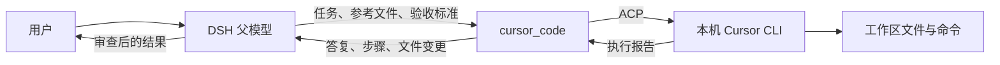

# dsh-cursor-dev

**让 DSH 中支持工具调用的父模型，把任务交给本机 Cursor CLI 执行，再接收结果、审查修改并继续工作。**

父模型与 Cursor 使用的模型分别选择：例如父模型用 DeepSeek，Cursor 用 Auto；也可以让其他已接入 DSH 的模型派发同样的任务。

[中文](#中文) · [English](#english) · [安装与首次使用](docs/INSTALL.md)


## 中文

### 工作方式



- **父模型**理解需求、拆解任务、调用工具、审查结果。它的模型供应商和 API 配置由 DSH 管理。
- **Cursor CLI**使用自己的登录账号和可用模型执行任务，包括读取文件、修改代码、运行命令。
- **插件**启动或恢复 Cursor 会话，传入任务，记录执行过程，并把报告返回原来的父代理。`cursor_code` 的执行过程还会镜像到可点击的 DSH 子会话。

父模型不必是 Cursor 提供的模型。前提是它已接入 DSH、支持工具调用，并且当前会话允许使用插件的工具。这里的模型兼容性指 **DSH 内的父模型**；其他聊天应用需要另行接入，这个包没有提供通用 MCP 服务。

### 安装

完整步骤、升级说明和排错见 **[安装与首次使用](docs/INSTALL.md)**。

1. 安装当前版 Cursor CLI，运行 `agent login`，再用 `agent status --format json` 检查登录。
2. 在 DSH 插件管理中安装本插件。公开仓库的安装来源为：

   ```text
   git+https://github.com/Dclef/dsh-cursor-dev.git
   ```

   已配置 DSH 命令行的用户也可以在所用 profile 下执行：

   ```sh
   dsh plugin add "git+https://github.com/Dclef/dsh-cursor-dev.git"
   ```

   `0.11.0` 起也已发布到 npm 公共源，可以改用包名安装：

   ```sh
   dsh plugin add dsh-cursor-dev
   ```

3. 按 DSH 提示完成加载；涉及后台代码更新时重启 DSH，然后刷新页面。在 Cursor 面板中选择模型并保存。
4. 明确告诉父模型使用 `cursor_code`，或者用下面的斜杠命令派发第一个任务。

**版本说明（0.12.4）：** 本版把两个原本要手改配置才能调的开关搬进了面板的模型卡片。`maxChildDepth` 默认值从 `1` 改为 `2`——Cursor 是叶节点（CLI 里没有 DSH 工具，不可能再往下派），`2` 就是实际上限，旧的默认值只是把「子智能体派 Cursor」这件事拒掉了；该值改为每次调用现读，面板「子代理深度」的选择优先于配置，下一次调用生效、不用重载插件，越界的值（如手改成 `9`）当作「没设」回落到配置而不是被截断。新增「Cursor 署名」开关：Cursor 会给子智能体做的 commit 追加 `Co-authored-by: Cursor` 并在它开的 PR 上署名，而这个开关没有 CLI 参数也没有环境变量，只存在于 Cursor 自己的 `cli-config.json`，所以插件替你写那个文件——只改 `attribution` 两项、其余键原样保留、临时文件加改名、解析不了的文件绝不覆盖，默认关闭；保存后立即写入并在每次启动 CLI 前再确认一次（CLI 只在进程启动时读一次配置）。面板布局调整为模型选择器与保存按钮置顶、代理输入框移到它所解释的状态行下方，并删掉「来源与出口」折叠、并入「模型目录、搜索与来源」。保留额度耗尽保护：调用 `cursor_code` 或通过原生子智能体派发之前先检查 Cursor 用量，总、Auto、API 三个额度都到上限时直接拒绝并说明原因，不再把任务派出去后中途失败；用量接口暂时取不到时不拦截调用。`cursor_subagent` 也会生成可点击的对话子会话，面板里点运行中或已完成的行都能查看过程，不再报「没有可恢复的会话」。DSH 兼容性不变，仍显式声明支持 `0.2.0-rc.1`、`0.2.0-rc.2`、`0.2.1-rc.1`、`0.2.1-rc.2` 以及 `>=0.2.1 <0.3.0` 的稳定版本，开发依赖固定为 `0.2.1-rc.2`。插件市场已收录本插件，卡片版本随目录探测更新；npm 包名为 `dsh-cursor-dev`，实际已发布版本以 npm 的 `latest` 标签为准。要跟进后续改动请用 Git 来源；`.tgz` 是某一刻的固定快照。详见[安装来源与版本](docs/INSTALL.md#2-选择安装来源)。

运行要求：DSH `0.2.0-rc.1`、`0.2.0-rc.2`、`0.2.1-rc.1`、`0.2.1-rc.2` 或 `>=0.2.1 <0.3.0` 的稳定版本（已在 `0.2.1-rc.2` 上验证）；Node.js `^22.19.0 || >=24.0.0`；已登录且可访问服务的 Cursor CLI。原生子智能体功能需要 DSH 的 `subagents`、`agents` 服务，后台任务还需要对应任务服务，建议使用当前 DSH 桌面版。CLI 安装方法见 [Cursor 官方文档](https://cursor.com/docs/cli)。

### 三个入口

| 入口 | 用途 | 结果如何回来 |
| --- | --- | --- |
| `cursor_code` | 父模型派发完整任务，控制目录、模式、模型、会话与报告 | 工具结果回到调用它的父模型，包含答复、步骤和检测到的文件变更 |
| `/cursor-subagent 任务内容` | 用户直接派发一次任务；可选前缀 `-m 模型` | 完成或失败后，插件把摘要交给原父代理继续处理 |
| `cursor_subagent` | 当前源码新增的 DSH 原生一次性子智能体工具，可后台运行 | 使用 DSH 标准结果及后台任务机制；父会话保留一行 External 任务，Cursor 面板里的会话行可直接打开实时镜像子对话 |

例如，在一个空测试工作区发送：

```text
/cursor-subagent 创建 cursor-cli-check.txt，内容为 cursor-cli-ok，然后读取它确认内容。只修改这个文件，最后汇报结果。
```

或者直接对父模型说：

> 请使用 cursor_code 修复这个问题。先让 Cursor 读取相关文件，完成后检查返回的修改和测试结果，再向我汇报。

安装工具后，是否自动调用仍由父模型和会话指令决定。希望默认委派开发任务时，可以把下面的内容加入父代理的自定义指令：

```text
涉及代码实现、重构、修复或批量修改时，优先使用 cursor_code。
在 task 中说明完整目标，在 contextFiles 中列出需要先读的文件，
在 acceptance 中写清约束与验收要求。使用面板默认模型，除非用户要求切换。
收到结果后检查文件变更和验证记录；必要时继续派发修正。
同一任务使用相同 sessionLabel，并以 continueSession:true 续聊。
不同任务或项目使用不同 sessionLabel。没有修改需求的问题可直接回答。
```

### 给父模型的调用示例

第一次调用 `cursor_code`：

```json
{
  "task": "修复登录表单的空密码校验，沿用项目现有交互风格。",
  "contextFiles": ["src/login.ts", "test/login.test.ts"],
  "acceptance": "不改变公开接口；补充有意义的回归用例并运行相关测试。",
  "sessionLabel": "login-validation",
  "mode": "agent"
}
```

收到结果后，仍由同一个父代理调用：

```json
{
  "task": "继续处理刚才的任务：检查纯空格密码的边界情况，必要时修正并验证。",
  "sessionLabel": "login-validation",
  "continueSession": true
}
```

示例中的文件路径需要换成实际项目路径。Cursor 接收任务文本、参考文件提示和其已有的 Cursor 会话历史，不会自动读取整段父对话，所以父模型应把必要背景写进任务。

| 参数 | 说明 |
| --- | --- |
| `task` | 必填；完整任务目标 |
| `contextFiles` / `acceptance` | 参考文件列表、约束与验收标准 |
| `workspaceRoot` | 可选绝对路径；默认使用当前 DSH 会话工作区 |
| `model` | 可选 Cursor 模型；省略时使用面板选择及配置回退；面板锁定可覆盖此参数 |
| `mode` | `agent` 执行修改，`plan` 只读规划，`ask` 只读问答 |
| `sessionLabel` | 同一父会话中的任务标签，默认 `default`；不同任务建议分开命名 |
| `continueSession` | 复用当前会话执行后续任务；进程已退出时尝试从 Cursor 存储恢复 |
| `resetSession` | 清除该标签的插件映射并重新开始；不删除 Cursor 自己的历史文件 |
| `report` | `summary`（默认）或 `detailed` |
| `timeoutSeconds` | 默认 1800 秒，最大 7200 秒 |

结果包括成功状态、答复、会话标识、实际模型、执行步骤、预览和检测到的文件变更。当前源码还返回 `modelSource` 与 `requestedModel`，帮助判断模型选择来自面板锁定、调用参数还是默认配置。文件扫描有范围和数量限制，报告不代替父代理对实际工作区的最终检查。

### 模型选择与会话

- 父模型和 Cursor 模型独立配置。可用的 Cursor 模型由该账号的实时列表决定。
- 默认未锁定时，优先级为：调用的 `model` → 面板保存的模型 → 插件 `model` 配置 → CLI 默认值。
- 当前源码增加了“锁定面板模型”：保存后，面板选择优先于调用参数。选 Auto 并锁定，可防止父模型显式传入其他模型覆盖它。`auto` 和 `default[]` 表示同一个 Auto 选择。
- 保存的默认值与正在运行的模型分别显示；新选择在后续运行时应用，不会中途切换已经开始的任务。
- 会话按 **父代理 ID + `sessionLabel`** 记录。换一个父会话或标签，不会自动接上另一份会话。
- 改模型可能新起 CLI 进程，并尝试重载已保存的 Cursor 对话。`continueSession:false` 不应被当作清空历史的开关；需要全新上下文时使用新标签或 `resetSession:true`。
- 重启后的续聊依赖 Cursor 历史及插件映射仍存在；加载失败时会记录原因并回退到新会话。可检查报告中的 `reloaded`。
- Cursor 的模型选择是 CLI 全局状态，插件串行执行 Cursor 任务。不同标签隔离会话上下文，但不会自动隔离共用工作区的文件。

### 原生子智能体支持范围

当前源码注册 DSH 后端 `cursor`。有对应服务时，`cursor_code` 接入 DSH 的运行开始、结束与取消机制；bundle 同时配置标准工具 `cursor_subagent`，不修改已有通用 `subagent` 工具的默认后端。

执行仍由外部 Cursor CLI 完成，DSH 中的子会话负责展示过程。标准入口支持一次性前台或后台任务，后台任务可通过 DSH 的 `job_output` / `job_kill` 查看或取消。

目前支持 `cursor_code` 的显式续聊；**尚不支持通过 `send_message` 向 Cursor 投递持久消息，也没有把 Cursor 接成 Agent Teams 常驻队友**。精简 profile 缺少原生子智能体服务时，`cursor_code` 可以使用原有执行路径；镜像、面板和命令分别依赖对应的宿主服务。

### 面板、配置和数据

从 DSH 的 Cursor 插件入口打开面板，也可以访问当前 DSH 地址下的 `/plugins/dsh-cursor-dev/`。例如，DSH 运行在 `http://127.0.0.1:19387` 时，面板地址为 `http://127.0.0.1:19387/plugins/dsh-cursor-dev/`；其他用户应使用自己的地址和端口。

面板包含安装/登录状态、账号额度、模型和模式设置、活动与历史会话。点击会话可查看镜像记录。历史会话会一直累积，所以列表默认收在一个限高的滚动框里，点标题即可整段折叠（选择会被记住）；每行右侧的 **删除** 会清掉这次运行的全部痕迹——索引记录、轨迹和镜像子会话，和 `resetSession` 走同一条链路。删除要连点两次（第一次只是变成「确认删除」），因为删掉之后无法恢复。新版本页面可能与上面的截图不同。

| 插件配置 | 默认值 | 用途 |
| --- | --- | --- |
| `model` | 空字符串 | 面板未设置时的 Cursor 模型 |
| `maxLiveSessions` | `3` | 最多保留的 CLI 进程数，任务仍然串行 |
| `sessionIdleMinutes` | `15` | 空闲进程回收时间 |
| `maxScanFiles` | `20000` | 工作区变更扫描的文件数量上限 |
| `toolName` | `cursor_code` | 编码工具的注册名 |
| `usageUi` | `true` | 是否挂载状态、额度和面板 HTTP 路由 |
| `usageBaseUrl` | `https://api2.cursor.sh` | Cursor 额度 API 地址 |
| `maxChildDepth` | `2` | Cursor 子会话允许达到的深度上限，调用方深度必须小于该值（面板「子代理深度」可覆盖） |

插件自动探测 CLI 的 PATH 和已知安装目录。探测失败时，可在插件配置里设置 `command` 指向可启动的二进制、安装根目录、`agent.cmd`，或 `"node.exe" "index.js"`；非空时只使用该路径，不再回退到自动探测。安装排错以[指南](docs/INSTALL.md#6-常见问题)为准。

### 代理设置

面板的「子智能体模型」卡片里有**代理**输入框，未设置时默认为 `none`（直连）。

| 取值 | 含义 |
| --- | --- |
| `none`（默认） | 直连，并从 CLI 子进程环境中移除继承的代理地址变量 |
| 留空 | 自动探测：先看 `HTTPS_PROXY` 等环境变量，再看 Windows「Internet 选项」里的代理 |
| `http://127.0.0.1:7890` | 显式指定代理，优先于环境变量和注册表 |

**为什么需要它：** Cursor CLI 只读 `HTTPS_PROXY` / `HTTP_PROXY` / `https_proxy` / `http_proxy`——不读注册表，也不读 `ALL_PROXY`。所以一台只把代理写在「Internet 选项」里的机器，插件启动的 CLI 子进程会直连 Cursor，而直连只会拿到模型目录里的**一小部分**：本机实测 `agent --list-models` 为 **31 个**（走代理 **265 个**），ACP 会话清单为 **10 个**（走代理 **46 个**）。这就是「有些模型看不到」的全部原因。

需要系统代理时，主动清空输入框并保存；插件会把探测到的地址写进子进程环境（`HTTPS_PROXY`、`HTTP_PROXY` 及小写形式），并在模型卡片的「可选模型」那一行末尾显示**子进程出口**。升级时已保存的空值仍表示自动探测，不会被改成 `none`。面板保存后对后续启动的子进程生效，不必重启应用；如果填的值解析不了，那一行会直接说明。

模型卡片下方还有可搜索的模型浏览器：点一行设为面板模型，右边的开关决定它是否出现在上方下拉框里。关掉的模型只是藏起来（写入 `disabledModels`），点「保存」后生效，随时可以再打开——这样在完整目录有上百个模型时也能只留下写业务常用的几条。

`maxChildDepth` 限制的是**谁能启动 Cursor 子会话**：深度为 `0` 的顶层智能体是正常调用方，深度 `1` 的子智能体再调用就会被拒绝。默认值是 `2`，即允许父智能体和子智能体都创建 Cursor 子会话——Cursor 是个叶节点（CLI 里没有 DSH 工具，它不可能再往下派），所以 `2` 就是实际上限，再大的值和 `2` 完全等价。这个值可以在面板的「子代理深度」里改，面板的选择优先于配置；改完下一次调用生效，不需要重载插件。拒绝发生在创建任何进程或子会话之前，`cursor_code` 立即返回 `sessionKey: "depth-refused"`，`cursor_subagent` 抛出同类错误，错误信息里带有当前深度和上限。宿主本身对 `subagent` / `subagent_fork` 的深度限制（面板「子智能体 → 运行限制 → 最大递归深度」）仍然生效；`cursor` provider 声明 `depthLimit: false`，无法接收数值型 `maxDepth`，所以这道限制由本插件自己执行。把 `maxChildDepth` 设为 `0` 可以完全禁止子会话，设为 `2` 或更大则允许更深一层。镜像历史（面板里的记录）不受此限制，仍可正常打开查看。

插件设置与会话映射优先写入环境变量 `DSH_CURSOR_DEV_DATA` 指定的目录；否则使用 `%LOCALAPPDATA%/dsh-cursor-dev`；没有该环境变量时使用 DSH 提供的 `baseDir` 下的 `.data`（再无 `baseDir` 时回退到进程当前目录）。Cursor 登录和原始会话由 Cursor 自己保存。面板写操作包含同源检查，HTTP 可访问范围由 DSH 的监听配置决定。

### Cursor 署名

Cursor 默认会在子智能体做的提交上追加 `Co-authored-by: Cursor`，在它开的 PR 上署名。这些提交发生在别人的仓库里，而仓库的读者并没有同意这件事，所以面板里默认**关掉**：模型卡片底部的「Cursor 署名」选择「不加 Cursor 署名」，插件在下一次启动 CLI 前把 Cursor 自己的配置文件改成不署名。

这个开关没有 CLI 参数，也没有环境变量，只存在于 Cursor 的 `cli-config.json`：

```json
{ "attribution": { "attributeCommitsToAgent": false, "attributePRsToAgent": false } }
```

文件位置按 Cursor 自己的顺序解析：`CURSOR_CONFIG_DIR` → `XDG_CONFIG_HOME/cursor` → `~/.cursor`。插件只改 `attribution` 这两项，权限、模型、登录信息等其他键原样保留，写入走临时文件 + 改名；解析不了的文件不会被覆盖（那是 Cursor 自己的报错，不该由插件掩盖）。面板的三个选项：

| 选项 | 行为 |
| --- | --- |
| 不加 Cursor 署名（默认） | 把两项都写成 `false` |
| 保留 Cursor 署名 | 把两项都写成 `true` |
| 跟随 Cursor 自己的配置 | 插件不碰这个文件，你用自己的 Cursor 设置 |

保存后立即写入，并在每次启动 CLI 前再确认一次——因为 CLI 只在进程启动时读一次配置，已经在跑的会话要等新会话才生效。选择器下面那行「Cursor 当前：…」显示的是配置文件的实际状态，不是你的选择：用了「跟随」或者写入失败时，两者会不一样。团队管理员在服务端禁用署名（`attributionControls`）时，本地怎么写都不会恢复署名。

### 开发与验证

```sh
npm install
node --test --test-force-exit --test-skip-pattern="the child agent really edits a file|a bad model is rejected|the real Cursor account returns live quota data" "test/**/*.test.mjs"
```

完整测试命令为 `npm test`。上面的命令跳过三个真实 CLI/账号测试，不派发真实编码任务；其余 smoke 测试仍包含只读额度 HTTP 检查，因此并非完全离线。真实编码测试需要 Cursor 登录和网络，执行任务会使用该账号额度。Windows 下的 Keychain 测试因需要 POSIX shell 而跳过，不能据此认定 macOS 已验证；企业证书环境可使用 Node.js 的 `--use-system-ca`。打包使用 `npm pack` 或 `pnpm pack`，发布前按[分发检查](docs/INSTALL.md#7-维护者分发前检查)核对安装包和版本。

## English

**Use Cursor CLI as an execution agent for a tool-capable parent model in DSH. Results return to the same parent for review and follow-up.** The parent model and Cursor's model are configured independently. A DeepSeek parent can delegate to Cursor Auto, for example; the parent does not need to be a model offered by Cursor.

### Install and try it

See the [installation guide](docs/INSTALL.md) for detailed setup and troubleshooting.

1. Install the current [Cursor CLI](https://cursor.com/docs/cli), run `agent login`, and check `agent status --format json`.
2. Install the plugin through DSH's plugin manager using `git+https://github.com/Dclef/dsh-cursor-dev.git`. With the DSH CLI configured for your intended profile, use:

   ```sh
   dsh plugin add "git+https://github.com/Dclef/dsh-cursor-dev.git"
   ```

   From `0.11.0` on the package is also published to the public npm registry, so the bare name works:

   ```sh
   dsh plugin add dsh-cursor-dev
   ```

3. Restart DSH when backend changes require it, then refresh the page. Open the Cursor panel under `/plugins/dsh-cursor-dev/`, select a model and save it. The history list keeps one row per run forever, so it sits in a height-capped scroll box and folds away when you click its heading (the choice is remembered); a row's **Delete** link clears that run's index record, journal and mirrored child — the same chain `resetSession` uses — and arms on the first click so the irreversible second click is deliberate.
4. Ask the parent to use `cursor_code`, or send `/cursor-subagent` followed by a complete task. The command dispatches directly and hands a completion or failure summary back to the original parent.

Version `0.12.4` moves two settings that used to need a hand-edited profile, or a hand-edited file belonging to another program, into the model card. `maxChildDepth` now defaults to `2` instead of `1`: a Cursor run is a leaf — the CLI has no DSH tools, so it can never delegate further, which makes `2` the real ceiling and the old default refused the delegation people actually try. The cap is read per call, the panel's **Subagent depth** picker wins over the config, it applies on the next call without a reload, and an out-of-range value (a hand-edited `9`) is treated as unset rather than clamped. A new **Cursor credit** switch exists because Cursor appends `Co-authored-by: Cursor` to the commits its agent makes and credits itself on the pull requests it opens, and that switch has no flag and no environment variable — it lives only in Cursor's own `cli-config.json`, so the plugin writes that file: exactly the two `attribution` keys, every other key preserved, through a temporary file and a rename, and a file it cannot parse is never replaced. It is off by default, applied on save and re-checked before every spawn, because the CLI reads its settings once at startup. The panel now leads the model card with the model picker and its save button, puts the proxy box under the status line it is about, and folds the former "sources" note into the catalogue fold. Quota exhaustion protection is retained: before `cursor_code` or a native subagent call starts, the plugin reads Cursor usage and refuses the call, explaining why, when the total, Auto and API buckets are all at their limit, instead of dispatching a run that later fails mid-way. A usage lookup that cannot be completed never blocks a call. `cursor_subagent` also creates a clickable transcript child, so rows for running and finished runs open in the panel instead of reporting that no durable conversation exists. DSH compatibility is unchanged: support is declared for `0.2.0-rc.1`, `0.2.0-rc.2`, `0.2.1-rc.1`, `0.2.1-rc.2` and stable versions `>=0.2.1 <0.3.0`, with the `@deepseek-ai/dsh` development dependency pinned to exactly `0.2.1-rc.2`. The dsh-market catalog already lists this plugin and updates its displayed version on subsequent probes. The public npm package is `dsh-cursor-dev`; its `latest` tag identifies the published version. Use the Git source to follow later changes; a `.tgz` is a fixed snapshot.

Requirements: DSH `0.2.0-rc.1`, `0.2.0-rc.2`, `0.2.1-rc.1`, `0.2.1-rc.2` or a stable version `>=0.2.1 <0.3.0` (verified against `0.2.1-rc.2`); Node.js `^22.19.0 || >=24.0.0`; an authenticated Cursor CLI account with service access. Native dispatch additionally needs DSH's `subagents` and `agents` services, and background runs need the host's job services. A current DSH desktop installation is recommended.

### Parent-to-child contract

- `cursor_code` takes a complete `task`, optional `contextFiles` and `acceptance`, an absolute `workspaceRoot`, and optional model, mode, session and report settings. It returns the final reply, steps and detected file changes to its caller.
- The child receives the delegated task and its own Cursor history, not the whole parent conversation. Include the context it needs.
- Use the same `sessionLabel` and `continueSession: true` for follow-ups from the same parent. Use a new label or `resetSession: true` to start without the previous mapping. `continueSession: false` alone does not guarantee an empty persistent history.
- A model change may start another CLI process and reload the saved Cursor conversation. Recovery depends on the saved records still being available; load failure falls back to a new session.
- Cursor runs are serialized because its model selection is global. Labels isolate conversation context, not files in a shared workspace.
- The parent must support tool calling and have the tool enabled. Installing this plugin does not force every parent to delegate automatically. Other chat applications require a separate integration; this package is not a general MCP server.

The default model order is call argument → saved panel choice → plugin configuration → CLI default. In the current source, locking the panel choice overrides a per-call model argument. Auto and `default[]` are the same choice. The returned `modelSource` and `requestedModel` explain the selection.

### Native execution and limits

The current source registers a native DSH provider named `cursor` and a standard one-shot tool named `cursor_subagent`. Rich `cursor_code` calls also use the native lifecycle when those host services exist. The existing generic `subagent` backend remains configured as before.

Cursor executes externally. From DSH 0.2.1 on, the host writes a single non-interactive `External` row for a `cursor_subagent` run. Both entrances also create a real transcript child that the Cursor panel opens while the first turn is running. The native service keeps its own lifecycle id; the separate transcript child does not add a duplicate catalog row. Standard background runs use DSH's job result and cancellation tools. Persistent mailbox continuation through `send_message`, and Cursor as a resident Agent Teams teammate, are not implemented. Use `cursor_code` with `continueSession` for explicit follow-ups.

The parent remains responsible for reviewing the actual changes and verification evidence. File reports have scan limits and are not a substitute for final workspace checks. Cursor model availability and usage depend on the Cursor account; the parent model uses its separate DSH provider configuration.

`maxChildDepth` (default `2`) caps who may start a Cursor child session. A top-level agent at depth `0` is the intended caller; a subagent at depth `1` that calls `cursor_code` or `cursor_subagent` is refused before any process, child session, or reset is created — `cursor_code` returns `sessionKey: "depth-refused"` and the error names both the current depth and the cap. This exists because the `cursor` provider declares `depthLimit: false` and cannot accept a numeric `maxDepth` from the host's `tool-subagent`, so the plugin enforces the limit itself. Set it to `0` to forbid Cursor children entirely, or `1` to keep delegation to the top-level agent only. The default of `2` lets a subagent start one too, because a Cursor run is a leaf — the CLI has no DSH tools, so it can never delegate further and every value above `2` behaves exactly like `2`. The settings panel's **Subagent depth** picker writes the same value and wins over this config; a change applies on the next call without reloading the plugin. The host's own delegation limit for `subagent` / `subagent_fork` (panel → Subagents → Run limits → maximum recursion depth) still applies independently. Opening a mirrored child conversation in the panel is a read-only record and is not affected.

### Proxy

The **子智能体模型** card carries a **proxy** box, empty by default.

| Value | Meaning |
| --- | --- |
| empty (default) | detect it: `HTTPS_PROXY` and friends first, then the Windows Internet Settings proxy |
| `none` | never proxy |
| `http://127.0.0.1:7890` | that proxy, ahead of both of the above |

Why it exists: the Cursor CLI reads `HTTPS_PROXY` / `HTTP_PROXY` / `https_proxy` / `http_proxy` and nothing else — not the Windows registry, and not `ALL_PROXY`. On a machine whose only proxy lives in Internet Settings, the CLI child therefore reaches Cursor directly, and the direct route publishes only a fraction of the catalogue: measured on this machine, `agent --list-models` answers **31** models directly and **265** through the proxy, while the ACP roster the picker actually uses goes from **10** to **46**. That is the whole of the "some models are missing" symptom.

Leaving the box empty already fixes it, so no configuration is normally needed: the plugin resolves the route, writes `HTTPS_PROXY`/`HTTP_PROXY` (and the lowercase spellings) into every child process it starts, and shows the result as **子进程出口** at the end of the *available models* line. Saving takes effect on the next spawn rather than the next restart, and a value that cannot be parsed is reported on that same line instead of being silently ignored.

### Cursor attribution

Cursor appends `Co-authored-by: Cursor` to the commits its agent makes, and credits itself on the pull requests it opens. Those commits land in repositories whose readers never agreed to that, so the panel turns it **off** by default: the **Cursor credit** picker at the bottom of the model card keeps the CLI's own settings file saying "no attribution", and the plugin applies that before the next CLI process starts.

There is no flag and no environment variable for this — the only switch is Cursor's `cli-config.json`:

```json
{ "attribution": { "attributeCommitsToAgent": false, "attributePRsToAgent": false } }
```

The file lives where Cursor looks for it: `CURSOR_CONFIG_DIR`, else `XDG_CONFIG_HOME/cursor`, else `~/.cursor`. The plugin writes only those two keys — permissions, models, and auth information are preserved byte for byte — through a temporary file and a rename, and a file it cannot parse is left alone rather than replaced (that is Cursor's error to report). The three choices:

| Choice | Effect |
| --- | --- |
| No Cursor credit (default) | writes both flags as `false` |
| Credit Cursor | writes both flags as `true` |
| Leave Cursor own setting alone | the plugin never touches the file |

Saving applies immediately, and every spawn re-checks the file, because the CLI reads its configuration once at startup — a session already running keeps the old value until a new session starts. The `Cursor now:` line under the picker reports the state of the file, not your choice: with "leave alone" or after a failed write, the two differ. When a team administrator disables attribution server-side (`attributionControls`), no local setting turns it back on.

## License

[MIT](LICENSE)
