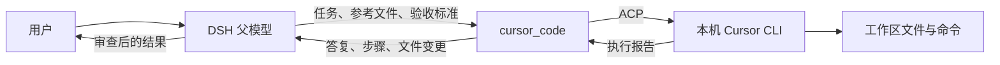

# dsh-cursor-dev

**让 DSH 中支持工具调用的父模型，把任务交给本机 Cursor CLI 执行，再接收结果、审查修改并继续工作。**

父模型与 Cursor 使用的模型分别选择：例如父模型用 DeepSeek，Cursor 用 Auto；也可以让其他已接入 DSH 的模型派发同样的任务。

[中文](#中文) · [English](#english) · [安装与首次使用](docs/INSTALL.md)


## 中文

### 工作方式



- **父模型**理解需求、拆解任务、调用工具、审查结果。它的模型供应商和 API 配置由 DSH 管理。
- **Cursor CLI**使用自己的登录账号和可用模型执行任务，包括读取文件、修改代码、运行命令。
- **插件**启动或恢复 Cursor 会话，传入任务，记录执行过程，并把报告返回原来的父代理。Cursor 的执行过程还会镜像到可点击的 DSH 子会话。

父模型不必是 Cursor 提供的模型。前提是它已接入 DSH、支持工具调用，并且当前会话允许使用插件的工具。这里的模型兼容性指 **DSH 内的父模型**；其他聊天应用需要另行接入，这个包没有提供通用 MCP 服务。

### 安装

完整步骤、升级说明和排错见 **[安装与首次使用](docs/INSTALL.md)**。

1. 安装当前版 Cursor CLI，运行 `agent login`，再用 `agent status --format json` 检查登录。
2. 在 DSH 插件管理中安装本插件。公开仓库的安装来源为：

   ```text
   git+https://github.com/Dclef/dsh-cursor-dev.git
   ```

   已配置 DSH 命令行的用户也可以在所用 profile 下执行：

   ```sh
   dsh plugin add "git+https://github.com/Dclef/dsh-cursor-dev.git"
   ```

3. 按 DSH 提示完成加载；涉及后台代码更新时重启 DSH，然后刷新页面。在 Cursor 面板中选择模型并保存。
4. 明确告诉父模型使用 `cursor_code`，或者用下面的斜杠命令派发第一个任务。

**版本说明（2026-10-13 核对）：** npm 公共源尚未提供 `dsh-cursor-dev`，因此目前不要只按包名安装。本文描述当前源码；本轮新增的原生子智能体接入和面板模型锁定仍是本地未发布改动。GitHub 安装只取得已经推送的代码；要试用当前修改，使用包含这些修改的源码目录或维护者提供的 `.tgz` 包。详见[安装来源与版本](docs/INSTALL.md#2-选择安装来源)。

运行要求：DSH 包声明最低版本 `>=0.2.0-rc.1`；Node.js `^22.19.0 || >=24.0.0`；已登录且可访问服务的 Cursor CLI。原生子智能体功能需要 DSH 的 `subagents`、`agents` 服务，后台任务还需要对应任务服务，建议使用当前 DSH 桌面版。CLI 安装方法见 [Cursor 官方文档](https://cursor.com/docs/cli)。

### 三个入口

| 入口 | 用途 | 结果如何回来 |
| --- | --- | --- |
| `cursor_code` | 父模型派发完整任务，控制目录、模式、模型、会话与报告 | 工具结果回到调用它的父模型，包含答复、步骤和检测到的文件变更 |
| `/cursor-subagent 任务内容` | 用户直接派发一次任务；可选前缀 `-m 模型` | 完成或失败后，插件把摘要交给原父代理继续处理 |
| `cursor_subagent` | 当前源码新增的 DSH 原生一次性子智能体工具，可后台运行 | 使用 DSH 标准结果及后台任务机制；完整过程可在镜像子会话中查看 |

例如，在一个空测试工作区发送：

```text
/cursor-subagent 创建 cursor-cli-check.txt，内容为 cursor-cli-ok，然后读取它确认内容。只修改这个文件，最后汇报结果。
```

或者直接对父模型说：

> 请使用 cursor_code 修复这个问题。先让 Cursor 读取相关文件，完成后检查返回的修改和测试结果，再向我汇报。

安装工具后，是否自动调用仍由父模型和会话指令决定。希望默认委派开发任务时，可以把下面的内容加入父代理的自定义指令：

```text
涉及代码实现、重构、修复或批量修改时，优先使用 cursor_code。
在 task 中说明完整目标，在 contextFiles 中列出需要先读的文件，
在 acceptance 中写清约束与验收要求。使用面板默认模型，除非用户要求切换。
收到结果后检查文件变更和验证记录；必要时继续派发修正。
同一任务使用相同 sessionLabel，并以 continueSession:true 续聊。
不同任务或项目使用不同 sessionLabel。没有修改需求的问题可直接回答。
```

### 给父模型的调用示例

第一次调用 `cursor_code`：

```json
{
  "task": "修复登录表单的空密码校验，沿用项目现有交互风格。",
  "contextFiles": ["src/login.ts", "test/login.test.ts"],
  "acceptance": "不改变公开接口；补充有意义的回归用例并运行相关测试。",
  "sessionLabel": "login-validation",
  "mode": "agent"
}
```

收到结果后，仍由同一个父代理调用：

```json
{
  "task": "继续处理刚才的任务：检查纯空格密码的边界情况，必要时修正并验证。",
  "sessionLabel": "login-validation",
  "continueSession": true
}
```

示例中的文件路径需要换成实际项目路径。Cursor 接收任务文本、参考文件提示和其已有的 Cursor 会话历史，不会自动读取整段父对话，所以父模型应把必要背景写进任务。

| 参数 | 说明 |
| --- | --- |
| `task` | 必填；完整任务目标 |
| `contextFiles` / `acceptance` | 参考文件列表、约束与验收标准 |
| `workspaceRoot` | 可选绝对路径；默认使用当前 DSH 会话工作区 |
| `model` | 可选 Cursor 模型；省略时使用面板选择及配置回退；面板锁定可覆盖此参数 |
| `mode` | `agent` 执行修改，`plan` 只读规划，`ask` 只读问答 |
| `sessionLabel` | 同一父会话中的任务标签，默认 `default`；不同任务建议分开命名 |
| `continueSession` | 复用当前会话执行后续任务；进程已退出时尝试从 Cursor 存储恢复 |
| `resetSession` | 清除该标签的插件映射并重新开始；不删除 Cursor 自己的历史文件 |
| `report` | `summary`（默认）或 `detailed` |
| `timeoutSeconds` | 默认 1800 秒，最大 7200 秒 |

结果包括成功状态、答复、会话标识、实际模型、执行步骤、预览和检测到的文件变更。当前源码还返回 `modelSource` 与 `requestedModel`，帮助判断模型选择来自面板锁定、调用参数还是默认配置。文件扫描有范围和数量限制，报告不代替父代理对实际工作区的最终检查。

### 模型选择与会话

- 父模型和 Cursor 模型独立配置。可用的 Cursor 模型由该账号的实时列表决定。
- 默认未锁定时，优先级为：调用的 `model` → 面板保存的模型 → 插件 `model` 配置 → CLI 默认值。
- 当前源码增加了“锁定面板模型”：保存后，面板选择优先于调用参数。选 Auto 并锁定，可防止父模型显式传入其他模型覆盖它。`auto` 和 `default[]` 表示同一个 Auto 选择。
- 保存的默认值与正在运行的模型分别显示；新选择在后续运行时应用，不会中途切换已经开始的任务。
- 会话按 **父代理 ID + `sessionLabel`** 记录。换一个父会话或标签，不会自动接上另一份会话。
- 改模型可能新起 CLI 进程，并尝试重载已保存的 Cursor 对话。`continueSession:false` 不应被当作清空历史的开关；需要全新上下文时使用新标签或 `resetSession:true`。
- 重启后的续聊依赖 Cursor 历史及插件映射仍存在；加载失败时会记录原因并回退到新会话。可检查报告中的 `reloaded`。
- Cursor 的模型选择是 CLI 全局状态，插件串行执行 Cursor 任务。不同标签隔离会话上下文，但不会自动隔离共用工作区的文件。

### 原生子智能体支持范围

当前源码注册 DSH 后端 `cursor`。有对应服务时，`cursor_code` 接入 DSH 的运行开始、结束与取消机制；bundle 同时配置标准工具 `cursor_subagent`，不修改已有通用 `subagent` 工具的默认后端。

执行仍由外部 Cursor CLI 完成，DSH 中的子会话负责展示过程。标准入口支持一次性前台或后台任务，后台任务可通过 DSH 的 `job_output` / `job_kill` 查看或取消。

目前支持 `cursor_code` 的显式续聊；**尚不支持通过 `send_message` 向 Cursor 投递持久消息，也没有把 Cursor 接成 Agent Teams 常驻队友**。精简 profile 缺少原生子智能体服务时，`cursor_code` 可以使用原有执行路径；镜像、面板和命令分别依赖对应的宿主服务。

### 面板、配置和数据

从 DSH 的 Cursor 插件入口打开面板，也可以访问当前 DSH 地址下的 `/plugins/dsh-cursor-dev/`。例如，DSH 运行在 `http://127.0.0.1:19387` 时，面板地址为 `http://127.0.0.1:19387/plugins/dsh-cursor-dev/`；其他用户应使用自己的地址和端口。

面板包含安装/登录状态、账号额度、模型和模式设置、活动与历史会话。点击会话可查看镜像记录。新版本页面可能与上面的截图不同。

| 插件配置 | 默认值 | 用途 |
| --- | --- | --- |
| `model` | 空字符串 | 面板未设置时的 Cursor 模型 |
| `maxLiveSessions` | `3` | 最多保留的 CLI 进程数，任务仍然串行 |
| `sessionIdleMinutes` | `15` | 空闲进程回收时间 |
| `maxScanFiles` | `20000` | 工作区变更扫描的文件数量上限 |
| `toolName` | `cursor_code` | 编码工具的注册名 |
| `usageUi` | `true` | 是否挂载状态、额度和面板 HTTP 路由 |
| `usageBaseUrl` | `https://api2.cursor.sh` | Cursor 额度 API 地址 |

插件自动探测 CLI 的 PATH 和已知安装目录。当前实现不支持通过配置中的 `command` 覆盖探测结果，安装排错以[指南](docs/INSTALL.md#6-常见问题)为准。

插件设置与会话映射优先写入环境变量 `DSH_CURSOR_DEV_DATA` 指定的目录；否则使用 `%LOCALAPPDATA%/dsh-cursor-dev`；没有该环境变量时使用 DSH 提供的 `baseDir` 下的 `.data`（再无 `baseDir` 时回退到进程当前目录）。Cursor 登录和原始会话由 Cursor 自己保存。面板写操作包含同源检查，HTTP 可访问范围由 DSH 的监听配置决定。

### 开发与验证

```sh
npm install
node --test --test-force-exit --test-skip-pattern="the child agent really edits a file|a bad model is rejected|the real Cursor account returns live quota data" "test/**/*.test.mjs"
```

完整测试命令为 `npm test`，其中三个真实 CLI/账号测试需要 Cursor 登录和网络，执行任务会使用该账号额度。当前实现已通过 178 项离线测试，并完成两轮真实 Auto 调用、文件修改和上下文续接验证。打包使用 `npm pack` 或 `pnpm pack`，发布前按[分发检查](docs/INSTALL.md#7-维护者分发前检查)核对安装包和版本。

## English

**Use Cursor CLI as an execution agent for a tool-capable parent model in DSH. Results return to the same parent for review and follow-up.** The parent model and Cursor's model are configured independently. A DeepSeek parent can delegate to Cursor Auto, for example; the parent does not need to be a model offered by Cursor.

### Install and try it

See the [installation guide](docs/INSTALL.md) for detailed setup and troubleshooting.

1. Install the current [Cursor CLI](https://cursor.com/docs/cli), run `agent login`, and check `agent status --format json`.
2. Install the plugin through DSH's plugin manager using `git+https://github.com/Dclef/dsh-cursor-dev.git`. With the DSH CLI configured for your intended profile, use:

   ```sh
   dsh plugin add "git+https://github.com/Dclef/dsh-cursor-dev.git"
   ```

3. Restart DSH when backend changes require it, then refresh the page. Open the Cursor panel under `/plugins/dsh-cursor-dev/`, select a model and save it.
4. Ask the parent to use `cursor_code`, or send `/cursor-subagent` followed by a complete task. The command dispatches directly and hands a completion or failure summary back to the original parent.

As checked on **2026-10-13**, the package is not published to the public npm registry. GitHub installation only includes pushed code. The native-provider and model-lock additions documented here are local, unpublished changes at that date; use a source checkout containing them or a supplied `.tgz` to try that snapshot. Do not assume a bare package-name installation is available.

Requirements: DSH metadata declares `>=0.2.0-rc.1`; Node.js `^22.19.0 || >=24.0.0`; an authenticated Cursor CLI account with service access. Native dispatch additionally needs DSH's `subagents` and `agents` services, and background runs need the host's job services. A current DSH desktop installation is recommended.

### Parent-to-child contract

- `cursor_code` takes a complete `task`, optional `contextFiles` and `acceptance`, an absolute `workspaceRoot`, and optional model, mode, session and report settings. It returns the final reply, steps and detected file changes to its caller.
- The child receives the delegated task and its own Cursor history, not the whole parent conversation. Include the context it needs.
- Use the same `sessionLabel` and `continueSession: true` for follow-ups from the same parent. Use a new label or `resetSession: true` to start without the previous mapping. `continueSession: false` alone does not guarantee an empty persistent history.
- A model change may start another CLI process and reload the saved Cursor conversation. Recovery depends on the saved records still being available; load failure falls back to a new session.
- Cursor runs are serialized because its model selection is global. Labels isolate conversation context, not files in a shared workspace.
- The parent must support tool calling and have the tool enabled. Installing this plugin does not force every parent to delegate automatically. Other chat applications require a separate integration; this package is not a general MCP server.

The default model order is call argument → saved panel choice → plugin configuration → CLI default. In the current source, locking the panel choice overrides a per-call model argument. Auto and `default[]` are the same choice. The returned `modelSource` and `requestedModel` explain the selection.

### Native execution and limits

The current source registers a native DSH provider named `cursor` and a standard one-shot tool named `cursor_subagent`. Rich `cursor_code` calls also use the native lifecycle when those host services exist. The existing generic `subagent` backend remains configured as before.

Cursor executes externally; a real DSH child session mirrors the transcript for inspection. Standard background runs use DSH's job result and cancellation tools. Persistent mailbox continuation through `send_message`, and Cursor as a resident Agent Teams teammate, are not implemented. Use `cursor_code` with `continueSession` for explicit follow-ups.

The parent remains responsible for reviewing the actual changes and verification evidence. File reports have scan limits and are not a substitute for final workspace checks. Cursor model availability and usage depend on the Cursor account; the parent model uses its separate DSH provider configuration.

## License

[MIT](LICENSE)
